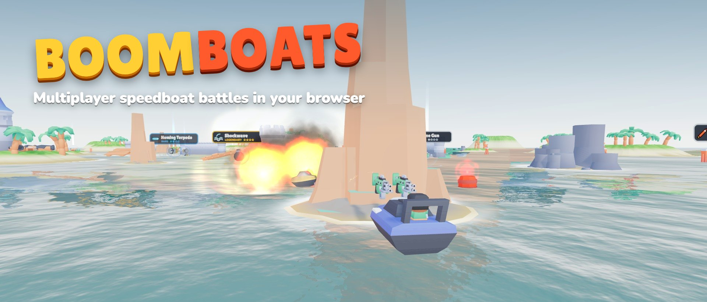

<p align="center"></p>

<p align="center"><b><a href="https://boomboats.suyogsavalkar.workers.dev">▶ Play now</a></b> · works on desktop and phones (landscape)</p>

Grab floating weapons, hide behind rocks and walls, and sink your friends' boats. Matches last 3 minutes; the most sinks wins. Up to 8 players per room, with bots filling empty seats.

## Play

- **PLAY** joins the busiest public room. **Create private room** gives you an invite link and a 5-letter code.
- Drive with **WASD** / arrows (joystick on phones). **One tap** of Space, click or FIRE uses your whole weapon.
- Sunk? You watch whoever got you, then **REVIVE** after 5 s with 4 s of spawn protection.

| Weapon | Power | One tap does |
| --- | --- | --- |
| Machine Gun | Common | fires 30 bullets; 8 hits sink a boat |
| Rockets | Common | fires 3 rockets in a row; 1 hit sinks |
| Sea Mines | Rare | drops 3 mines behind you (10 s; harmless to you) |
| Homing Torpedo | Rare | chases the boat in front of you |
| Shield | Rare | 6 s of invincibility |
| Turbo Ram | Epic | speed burst; ramming sinks boats |
| Shockwave | Legendary | sinks every boat in the circle around you |

## Run locally

```bash
npm install
npm start          # http://localhost:3000
```

## Deploy (Cloudflare Workers)

```bash
npx wrangler login
npx wrangler secret put ADMIN_KEY   # password for the /admin stats page
npx wrangler secret put IP_SALT     # any random string; used to scramble IPs
npm run deploy
```

Static files are served from Workers Static Assets, rooms run in a Durable Object (`Lobby`), and stats live in a second Durable Object with SQLite (`Stats`). Everything fits in the free plan.

## Stats dashboard

`/admin` (key required) shows unique users, players, names, private rooms, time played, returning players, devices, countries and live rooms. IP addresses are stored only as salted hashes.

## Code

| Path | What |
| --- | --- |
| `game.js` | Server-side game: rooms, bots, weapons, hits (shared by Node and Cloudflare) |
| `server.js` | Local Node server |
| `worker/index.js` | Cloudflare Worker + `Lobby` and `Stats` Durable Objects |
| `public/js/` | three.js client (world, boats, effects, HUD, aiming) |
| `public/js/shared/data.js` | Map, weapons and boat physics shared by server and client |
| `public/admin/` | Stats dashboard |

## Credits

3D models and effects: [Kenney](https://kenney.nl) (CC0). Explosion sounds by qubodup (CC-BY 3.0). Music "Awake!" by cynicmusic (CC0). Full list in [`public/audio/CREDITS.txt`](public/audio/CREDITS.txt).
